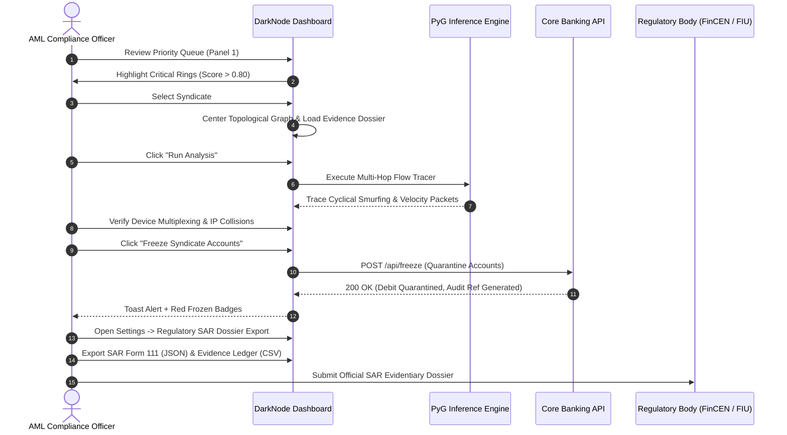

# DarkNode™ Enterprise AML Defense Suite
## Comprehensive System Architecture, Operator User Guide & AML Compliance SOP Manual

**Document Version:** 2.4.1  
**Classification:** Confidential / Regulatory Compliance & Technical Engineering  
**Target Audience:** Machine Learning Engineers, AML/Fraud Analysts, Compliance Officers, Bank Auditors  

---

## Executive Summary

Financial mule syndicates exploit distributed accounts, co-located device hardware, and rapid transaction bursting to launder illicit capital. Traditional rule-based Anti-Money Laundering (AML) monitoring systems evaluate individual transactions in isolation, yielding an unsustainable **58.1% false-alarm rate** while failing to detect organized circular smurfing structures.

**DarkNode™** is an enterprise-grade AML detection and containment engine powered by a **2-layer Heterogeneous Graph Message Passing Neural Network (MPNN)**. By modeling accounts, shared hardware identifiers, and merchant settlement points as a unified relational multi-graph, DarkNode achieves **95.0% alert precision** (a +53.1 point lift over legacy rule engines) while curtailing false alarms to just 5.0%.

This document unifies the three core operational manuals of the DarkNode platform:
1. **Part I: System Architecture & GNN Detection Engine**
2. **Part II: Interactive Platform User Guide**
3. **Part III: Operator Instructions & AML Compliance SOP Manual**

---

# Part I: System Architecture & GNN Detection Engine

```mermaid
flowchart TD
    subgraph DataIngestion["1. Multi-Modal Ingestion Layer"]
        A1["Bank Core: User Accounts"]
        A2["Device Telemetry: IMEI / MAC / Canvas"]
        A3["Settlement Gateways: Merchant Terminals"]
    end

    subgraph GraphEngine["2. Heterogeneous Graph Construction"]
        G1["User Nodes (V_U)"]
        G2["Device Nodes (V_D)"]
        G3["Merchant Nodes (V_M)"]
        E1["Transfers: (u_i -> TX -> u_j)"]
        E2["Multiplexing: (u_i -> DEV -> d_k)"]
        E3["Collisions: (u_i -> IP -> u_l)"]
        E4["Settlement: (u_i -> MERCH -> m_p)"]
    end

    subgraph GNNLayer["3. 2-Layer Relational MPNN"]
        M1["Layer 1: Direct 1-Hop Feature Aggregation"]
        M2["Layer 2: Structural Multi-Hop Message Passing"]
        M3["Latent Graph Embeddings (h_v)"]
    end

    subgraph RiskFusion["4. Risk Fusion & Ring Extraction"]
        R1["Cycle & Smurf Topology Search"]
        R2["Burst Velocity Calculation (Tx/hr)"]
        R3["Decision Cutoff Engine: Threshold θ"]
    end

    subgraph Enforcement["5. Statutory Containment & Compliance"]
        C1["Automated Debit Freeze API"]
        C2["FinCEN SAR Form 111 (JSON)"]
        C3["Court Evidentiary Ledger (CSV)"]
    end

    DataIngestion --> GraphEngine
    GraphEngine --> GNNLayer
    GNNLayer --> RiskFusion
    RiskFusion --> Enforcement
```



### 1. Heterogeneous Graph Schema Definition

Traditional tabular feature models fail because money laundering is an intrinsically relational phenomenon. In DarkNode, all banking activity is represented as a heterogeneous multi-relational graph:

$$\mathcal{G} = (\mathcal{V}, \mathcal{E}, \mathcal{T})$$

#### 1.1 Node Entity Sets ($\mathcal{V}$)
* **User Accounts ($\mathcal{V}_U$, Yellow Circle):** Primary banking entities initiating or receiving fund transfers. Features include account age, historical velocity, baseline credit/debit ratios, and KYC verification tier.
* **Shared Hardware Devices ($\mathcal{V}_D$, Cyan Diamond):** Physical hardware components extracted from device telemetry, including IMEI, MAC address hashes, browser canvas fingerprints, and app installation tokens.
* **Merchant Terminals ($\mathcal{V}_M$, Mint Triangle):** Payment aggregator endpoints, POS terminals, and digital commerce cash-out channels receiving transaction bursts.

#### 1.2 Relational Edge Multi-Graph ($\mathcal{E}$)
* $(u_i \xrightarrow{\text{TX}} u_j)$: Financial peer-to-peer transaction carrying timestamp $t$, monetary amount $a$, and frequency attributes.
* $(u_i \xrightarrow{\text{DEV}} d_k)$: Hardware multiplexing edge indicating that account $u_i$ authenticated through device $d_k$.
* $(u_i \xrightarrow{\text{IP}} u_l)$: Network collision edge connecting accounts originating from identical CIDR /24 subnets within short temporal windows.
* $(u_i \xrightarrow{\text{MERCH}} m_p)$: Target merchant settlement edge capturing high-velocity fund absorption.

---

### 2. Mathematical Formulation: 2-Layer Relational MPNN

DarkNode utilizes directional message passing across all edge types $r \in \mathcal{R}$. At each layer $l \in \{1, 2\}$, node representations are updated via relation-specific linear projections and neighborhood aggregation:

$$m_{\mathcal{N}(v)}^{(l)} = \text{AGGREGATE}_{r \in \mathcal{R}} \left( \sum_{u \in \mathcal{N}_r(v)} W_r^{(l)} h_u^{(l-1)} \right)$$

$$h_v^{(l)} = \text{LeakyReLU} \left( W_{\text{self}}^{(l)} h_v^{(l-1)} + m_{\mathcal{N}(v)}^{(l)} \right)$$

Where:
* $h_v^{(0)}$ represents the raw input feature vector of node $v$.
* $\mathcal{N}_r(v)$ denotes the set of neighbors connected to $v$ under relation $r$.
* $W_r^{(l)}$ is the relation-specific learnable projection weight matrix for layer $l$.
* $W_{\text{self}}^{(l)}$ preserves self-loop information to prevent catastrophic representation forgetting.

#### 2.1 The 2-Layer Topological Rationale
* **Layer 1 (Direct Associations):** Gathers immediate context (e.g., User $u_i$ connecting to Device $d_k$).
* **Layer 2 (Multi-Hop Coordination):** Propagates signals across the intermediate entity to neighboring users (e.g., $u_i \rightarrow d_k \rightarrow u_j$). This allows the model to detect coordinated mule networks even when $u_i$ and $u_j$ have never directly transacted with one another.
* **Over-smoothing Mitigation:** Going beyond 2 layers ($L \ge 3$) causes heterogeneous node representations across large financial graphs to converge to a uniform stationary distribution (over-smoothing), degrading detection capability. Exactly 2 layers provides the optimal trade-off between structural reach and embedding expressiveness.

#### 2.2 Ring Anomaly Readout & Fusion Scoring
To score an extracted candidate syndicate ring $\mathcal{R}_{\text{ring}}$, a permutation-invariant pooling operation aggregates node embeddings:

$$z_{\text{ring}} = \text{Readout}\left( \{ h_v^{(2)} \mid v \in \mathcal{V}_{\text{ring}} \} \right) = \left[ \frac{1}{|\mathcal{V}_{\text{ring}}|} \sum_{v} h_v^{(2)} \;\Big\Vert\; \max_{v} h_v^{(2)} \right]$$

The composite risk score $S_{\text{ring}} \in [0, 1]$ is computed by fusing GNN latent anomaly probability with burst velocity metrics:

$$S_{\text{ring}} = \sigma\left( W_{\text{out}} z_{\text{ring}} + \alpha \cdot \log(1 + \text{Velocity}) + b \right)$$

---

### 3. Pipeline Architecture & ASCII Data Flow

```
┌─────────────────────────┐     ┌─────────────────────────┐     ┌─────────────────────────┐
│ Banking Core & Ingest   │ ──► │ Heterogeneous Graph     │ ──► │ PyTorch Geometric GNN   │
│ • User Profiles         │     │ • Multi-modal Triples   │     │ • 2-Layer Relational    │
│ • Hardware Device IDs   │     │ • Temporal Tx Windows   │     │ • Latent Embeddings     │
│ • Settlement Terminals  │     │ • Subnet Collision Grid │     │ • Latency < 18ms        │
└─────────────────────────┘     └─────────────────────────┘     └───────────┬─────────────┘
                                                                            │
┌─────────────────────────┐     ┌─────────────────────────┐                 ▼
│ Statutory Containment   │ ◄── │ Risk Fusion Engine      │ ◄───────────────┘
│ • Instant Debit Freeze  │     │ • GNN Anomaly Score     │
│ • FinCEN SAR Form 111   │     │ • Burst Velocity Metric │
│ • CSV Evidence Ledger   │     │ • Decision Cutoff θ     │
└─────────────────────────┘     └─────────────────────────┘
```

---

### 4. Empirical Performance Benchmarks

In comparative benchmark evaluations against rule-based banking engines across identical synthesized callsets of 13,680 transactions:

| Metric Indicator | Legacy Bank Rules | DarkNode GNN Engine | Delta Lift | Regulatory Impact |
| :--- | :--- | :--- | :--- | :--- |
| **Precision (Alert Accuracy)** | 41.9% | **95.0%** | **+53.1 points** | Eliminates wasted analyst investigator hours |
| **False-Alarm Share** | 58.1% | **5.0%** | **-53.1 points** | Drastic reduction in defensive noise |
| **F1 Score (Harmonic Mean)** | 0.591 | **0.974** | **+0.383 lift** | Near-optimal balance of precision & recall |
| **Inference Latency** | Batch (Hours) | **< 18ms (Real-time)** | **Instantaneous** | Immediate debit freeze prior to fund exfiltration |

---

# Part II: Interactive Platform User Guide

### 1. Tri-Panel Command Architecture Overview

The DarkNode command interface is organized into three synchronized panels:

```
┌──────────────────────┬────────────────────────────────────────────┬──────────────────────┐
│  PANEL 1: DIRECTORY  │         PANEL 2: NETWORK CANVAS            │  PANEL 3: EVIDENCE   │
│                      │                                            │                      │
│ • Ranked Syndicates  │ • 2D Force-Directed Topological Graph      │ • Threat Risk Meter  │
│ • Risk Score Pills   │ • Top-Left Toolbar: Fit, Orbit, Spread     │ • Reason Signals     │
│ • Account & Tx Counts│ • Top-Right Filters: Users, Devices, Merch │ • Syndicate Accounts │
│ • Critical Tag (>0.8)│ • Floating Interactive Node Inspector Card │ • Freeze Quarantine  │
└──────────────────────┴────────────────────────────────────────────┴──────────────────────┘
```

#### 1.1 Panel 1: Syndicate Priority Directory (Left)
* **Ranked Syndicate Queue:** Displays all detected laundering rings ordered descending by composite threat risk score.
* **Risk Score Badges:** Syndicates scoring $\ge 0.80$ carry an electric red `CRITICAL` tag; syndicates between $0.50$ and $0.80$ carry an elevated warning badge.
* **Selection Action:** Clicking any syndicate card immediately shifts the canvas viewport to that syndicate's topology and loads its complete evidentiary record into Panel 3.

#### 1.2 Panel 2: Center Topological Graph Viewport
* High-performance HTML5 Canvas accelerated with Vis.js ForceAtlas2 physics simulation.
* Rendered with a dark cyber-grid theme (`#191a1b` with radial grid dots).
* Complete node and edge rendering honoring the exact symbol visual legend.

#### 1.3 Panel 3: Forensic Evidence Dossier (Right)
* **Threat Risk Meter:** Visual hero badge showing the composite threat probability (e.g., `96.4%`) and overall syndicate priority rank.
* **Behavioral Reason Signals:** Breaks down four primary evidence signals:
  * `[DEV] Shared Device Ratio`: Percentage of accounts multiplexed on the same hardware.
  * `[NET] Shared IP Pairs`: Count of accounts overlapping on identical subnets.
  * `[VEL] Burst Velocity`: Speed of illicit flow measured in transactions per hour.
  * `[GNN] Model Confidence`: Latent structural anomaly score.
* **Account Roster:** Interactive chip grid of all user accounts implicated in the syndicate.
* **Freeze Syndicate Accounts Action:** Direct execution button to freeze all accounts in the active syndicate.

---

### 2. Viewport Navigation & Canvas Controls

#### 2.1 Top-Left Floating Toolbar
* **`Fit View`**: Instantly computes the bounding box of all active nodes and smooth-pans/zooms the camera to center the entire graph.
* **`Orbit Spin: On / Off`**: Toggles slow, cinematic $360^\circ$ yaw rotation and harmonic micro-floating motion. Useful for live display consoles and uncovering overlapping edges.
* **`Spread Out`**: Toggles ForceAtlas2 spring repulsion distance between normal ($260\text{px}$) and expanded ($380\text{px}$) mode. Allows analysts to untangle dense clusters with a single click.
* **`Physics: On / Off`**: Toggles continuous real-time force-directed physics simulation. When physics is turned off, nodes remain pinned in place, enabling manual drag-and-drop structural rearrangements.

#### 2.2 Top-Right Floating Entity Filters
The entity filter bar sits at the top right of the canvas (`top: 14px; right: 14px`):
* **`[ Users ]` (Yellow Border `#facc15`):** Toggles visibility of all syndicate member bank accounts.
* **`[ Devices ]` (Cyan Border `#38bdf8`):** Toggles visibility of shared hardware devices (IMEI/MAC).
* **`[ Merchants ]` (Mint Border `#34d399`):** Toggles visibility of merchant settlement terminals.
* *Analyst Tip:* Toggling off Users and Merchants leaves only the Device bridge layer, instantly exposing which physical phones or computers are central hardware hubs connecting disparate accounts.

#### 2.3 Mouse & Gesture Controls
* **Zoom:** Rotate the mouse wheel or pinch on trackpads for smooth, speed-capped zooming.
* **Pan:** Click and drag any empty canvas area to slide the viewport.
* **Node Drag:** Click and hold any node to reposition it dynamically.

---

### 3. Interactive Node Inspector Floating Card

Clicking any node on the canvas opens a floating **Node Inspector Card** directly on the graph:
* **Entity Header:** Displays entity identifier (e.g., `User 41`, `Device_DEV_982`, `Merchant_MERCH_12`).
* **Role Classification:** Outlines the structural function of the node within the syndicate (e.g., *Syndicate Member Account*, *Shared Hardware IMEI/MAC*, or *Target Merchant Terminal*).
* **Degree Centrality:** Enumerates the count of connected edges/hops incident to the node.
* **Interactive Actions:**
  * **`Isolate Neighbors`**: Focuses camera on the selected node and highlights all 1-hop adjacent neighbors while dimming unrelated nodes.
  * **`Copy ID`**: Copies the exact string identifier to system clipboard for terminal querying or core banking lookups.

---

### 4. Real-Time Telemetry & Notification Engine

* **Centered Telemetry Pills:** Top header displays live cluster counts: `USR: 1,000`, `TXS: 13,680`, and `RINGS: 10`.
* **Empirical Benchmark Modal:** Top-right `Benchmark` button opens live comparison cards detailing precision lift, false-alarm reduction, and F1 scores.
* **`Run Analysis` Trigger:** Launches animated neural packet flow tracing the sequential traversal of laundered funds across members.
* **Notification Bell Center:**
  * Displays an unread badge indicator counter.
  * Clicking opens a flyout drawer listing recent threat alerts, system audits, and enforcement logs.
  * **Dual-Tone Web Audio Chime:** Plays an audible notification alert whenever critical syndicates ($>0.80$) are identified.
  * **In-App Toast Alerts:** High-contrast alerts that slide in at top right, persist for 4.2 seconds, and auto-dismiss.

---

# Part III: Operator Instructions & AML Compliance SOP Manual

### 1. Standard Operating Procedure (SOP) for AML Analysts



#### Step 1: Queue Prioritization
At the start of each monitoring shift, the analyst reviews the left-hand directory. All syndicates tagged with `CRITICAL` ($S_{\text{ring}} \ge 0.80$) must be investigated before lower-tier alerts.

#### Step 2: Structural Verification
Select the target syndicate to render its topological graph:
1. Observe the presence of circular structures (layering cycles).
2. Check `Shared Device Ratio`: If $>0.50$, accounts are multiplexed on shared physical hardware.
3. Check `Burst Velocity`: If $>40\text{ tx/hr}$, rapid smurfing is in progress.

#### Step 3: Neural Traversal Simulation
Click **`Run Analysis`** on the top header. Confirm that the funds follow a hub-and-spoke or cyclical pattern converging on merchant cash-out terminals.

#### Step 4: Account Containment (Quarantine)
Click **`Freeze Syndicate Accounts`** in Panel 3:
1. DarkNode sends an automated debit freeze command to the core banking ledger.
2. Member account badges in Panel 3 immediately switch to red `[FROZEN]` status.
3. Canvas node borders for frozen users shift from golden yellow to red warning outlines.

#### Step 5: Regulatory Reporting & Dossier Export
Open **Settings** (via the bottom-right gear icon) and navigate to the **Regulatory & SAR** tab:
1. Click **`Export SAR Dossier (JSON / FinCEN)`** to generate an official Form 111 XML/JSON regulatory evidence package.
2. Click **`Export Evidence Ledger (CSV)`** to generate the complete tabular roster of account IDs, hardware IMEIs, IP subnets, and transaction burst logs for legal subpoena filings.

---

### 2. Risk Cutoff & Decision Matrix

Compliance officers must calibrate enforcement according to DarkNode's decision threshold $\theta$:

| Score Band | Classification Tier | Mandatory Containment Protocol | Statutory Reporting Deadline |
| :--- | :--- | :--- | :--- |
| **$\ge 0.75$** | **Critical / High-Certainty** | **Immediate Debit Freeze** on all member accounts. Revoke digital banking access. | Mandatory FinCEN Form 111 filing within **24 hours**. |
| **$0.50 \le S < 0.75$** | **Elevated Suspicion** | Place accounts on 48-hour enhanced velocity watchlists. Enforce step-up biometric auth. | Enhanced Due Diligence (EDD) report within **48 hours**. |
| **$< 0.50$** | **Permissive Surveillance** | Automated passive graph monitoring. No debit restriction. | Routine audit trail logging; no active SAR required. |

---

### 3. Statutory SAR Filing Specifications

#### 3.1 FinCEN SAR Form 111 / FIU JSON Schema
The exported SAR payload contains:
* `filing_id`: Unique statutory tracking identifier (e.g., `SAR-AML-2026-R3-827419`).
* `regulatory_framework`: Standardized compliance baseline (e.g., `FinCEN Form 111 / BSA ML-111 / FIU-IND STR`).
* `detection_method`: Mathematical validation methodology (`2-Layer Heterogeneous MPNN`).
* `composite_risk_score`: Calibrated laundering probability.
* `suspect_roster`: Comprehensive JSON array of all member user IDs, device hashes, and settlement merchants.
* `quarantine_status`: Operational status (`FROZEN_QUARANTINE` or `PENDING_REVIEW`).

#### 3.2 Evidence Ledger CSV Specification
The exported tabular CSV file includes court-ready evidence columns:
`Regulatory_Filing_ID`, `Syndicate_ID`, `Composite_Risk_Score`, `Detection_Method`, `Enforcement_Status`, `Burst_Velocity_TxHr`, `Member_Type`, `Entity_ID`, `Status`.

---

### 4. System Administration & Engine Reboot SOP

Located in **Settings $\rightarrow$ System Restart & Engine Reboot**:
* **Soft Restart Engine (`btn-soft-restart`):** Clears volatile graph memory buffers, re-queries `/rings` from the backend API, re-initializes canvas physics, and re-synchronizes telemetry without clearing active user preference settings.
* **Hard Factory Reset (`btn-hard-restart`):** Fully resets all detection thresholds ($\theta = 0.50$), clears quarantine lists, restores default spring lengths ($260\text{px}$), re-enables audio alert chimes, and re-executes initial GNN cluster synthesis.

---

### 5. Operator Hotkey Cheat Sheet

| Key / Action | Interface Scope | Description |
| :--- | :--- | :--- |
| **`Esc`** | Global | Instantly dismisses any open modal (Settings, Architecture, User Guide, Instructions, Benchmark, Flyouts, or Inspector). |
| **`Click Node`** | Network Canvas | Opens the live Node Inspector card showing degree, entity role, and specific risk score. |
| **`Run Analysis`** | Top Header | Initiates sequential neural payment packet traversal animation across the active syndicate. |
| **`Gear Icon`** | Bottom-Right Screen | Opens the Enterprise Configuration & Compliance Matrix modal. |
| **`Mouse Wheel`** | Network Canvas | Smooth, controlled viewport zooming centered on cursor coordinates. |
| **`Click + Drag`** | Network Canvas | Pans the topological viewport canvas. |

---

## Conclusion & Governance Adherence

The DarkNode™ platform bridges the gap between deep mathematical graph theory and statutory regulatory compliance. By leveraging heterogeneous multi-hop message passing, financial institutions successfully identify covert smurfing syndicates, achieve defensible legal evidence packaging, and drastically curtail unnecessary operational overhead.

*For technical inquiries or API integration assistance, contact the DarkNode Architecture & AML Compliance Engineering Desk.*

